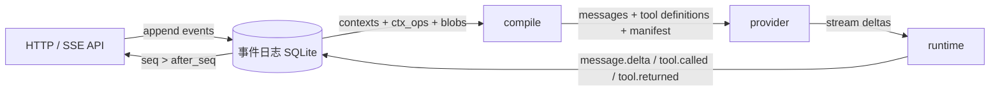

# WispStudio · Wisp

Go + Vue 3 + TypeScript 的本地 coding agent。事件日志是唯一事实来源：用户消息、模型增量、
工具调用与回合状态全部先落盘，再由 `compile` 投影成 provider 请求；前端通过 SSE 按 `seq`
回放，不依赖进程内状态。

## 架构



- **eventlog**：仅追加的事件日志。单 writer goroutine 分配 `seq`，事件与 blob 在同一事务落盘；
  `refs` 指针表达“现在走到哪里”，事件只描述事实。
- **compile**：从上下文 `base_ctx` 链、`ctx_ops` 与 `parent_id` 内容链生成消息列表，处理
  插入/隐藏/替换/置顶、工具调用成组与 `RequestManifest`。
- **provider**：OpenAI 兼容的 `/chat/completions` 客户端，负责流式解析、工具调用聚合、
  错误分类与重试；不感知事件。
- **runtime**：回合状态机。每轮读 `refs` + 折叠事件决定下一步：结清工具调用，或
  `compile → llm.requested → 流式调用 → message.delta / message.created / llm.responded`。
- **api**：会话、SSE、审批、模型目录与配置热更新；所有写入经 `eventlog.Writer`。

目录：

```
cmd/server          HTTP 服务入口
internal/api        HTTP/SSE 协议与配置接口
internal/compile    事件日志 → provider 消息
internal/config     Config.local.toml 解析、校验、原子写回
internal/eventlog   SQLite 事件日志、refs、blob、SSE 通知中心
internal/ids        强类型 ID
internal/provider   OpenAI 兼容客户端、模型目录与自动发现
internal/runtime    回合状态机与内置工具
tools/stress        200 轮压测
scripts/stats.sh    事件/ blob / 数据库体积统计
web                 Vue 3 前端
```

## 启动

需要 Go 1.22+、Node.js 和 npm。

```bash
cd web && npm ci && npm run build
cd .. && go build -o server ./cmd/server && ./server
```

首次启动会在**可执行文件同目录**生成 `Config.local.toml`（含明文密钥，请勿提交）。
默认监听 `http://127.0.0.1:8787`，事件日志在 `Data/eventlog.db`，工具工作区根也是
可执行文件同目录。`web/dist` 存在时同一端口直接托管前端。

开发前端：

```bash
cd web && npm run dev
```

## 配置

`Config.local.toml` 只有一份，键名使用 PascalCase：

```toml
[server]
Port = 8787

[[Providers]]
ProviderID   = "deepseek"                # 小写字母/数字/连字符
ProviderName = "深度求索"                 # 显示名，可中文
BaseURL      = "https://api.deepseek.com"
Secret       = "sk-..."                  # 明文
Models       = ["deepseek-chat"]         # 重复 id 会被去重

[Providers.Discovery]                    # GET {BaseURL}{Path} 自动发现
Enabled = true
Path    = "/models"                      # 必须以 / 开头

# 可选：给已有模型加显示别名
[[ModelAliases]]
ProviderID = "deepseek"
ModelID    = "deepseek-chat"
Alias      = "DeepSeek Chat"
```

保存规则：

- TOML 语法、`ProviderID` 正则（`^[a-z0-9]+(-[a-z0-9]+)*$`）、ProviderID 唯一、
  模型 id 非空且不含 `/`、`Models` 去重、`Discovery.Path` 以 `/` 开头（启用时不能为空）。
- **全部通过**才原子写回（同目录临时文件 + fsync + rename），随后热更新内存 catalog，
  不重启进程；解析、校验、写回任一步失败，旧文件与旧 catalog 都保持不变。
- `GET /api/config` 返回文件路径与原文；`POST /api/config` body 为 `{"Text":"..."}`。
  校验失败返回 400 与 `{"error":"...","line":N}`（`line=0` 表示无法定位），
  写回失败返回 500；两种情况旧文件都不变。
- 配置包含明文密钥，配置读写只接受本机 `Origin`。

## HTTP / SSE 协议

所有 JSON 字段使用 PascalCase；大块正文存 blob，读取时以 `BlobText` 返回。

| 方法 | 路径 | 说明 |
| --- | --- | --- |
| GET | `/api/health` | 存活检查 |
| GET | `/api/sessions` | 会话投影（标题、模型、消息/回合数、是否运行中） |
| POST | `/api/sessions` | 新建会话，body `{"Title","Model?"}` |
| DELETE | `/api/sessions/{sessionID}` | 软删除，回合执行/等待审批时返回 409 |
| GET | `/api/sessions/{sessionID}/events?after_seq=N` | SSE：回放 `seq>N`，再推送实时事件 |
| POST | `/api/sessions/{sessionID}/messages` | body `{"Text","Model?"}`，写用户消息 + 启动回合 |
| POST | `/api/sessions/{sessionID}/stop` | 停止当前回合或挂起的审批 |
| POST | `/api/sessions/{sessionID}/approvals/{toolCallID}` | body `{"Decision":"approved\|rejected","Reason?"}` |
| GET | `/api/models` | catalog 全量：手动模型、发现结果、别名、`ProviderName` |
| GET | `/api/config` | `{"Path","Text"}` 原文 |
| POST | `/api/config` | 校验并原子写回 + 热重建 catalog |
| GET | `/api/events/{eventID}/trace` | 沿 `cause_id` 回溯因果链 |

会话：

```json
{
  "ID": "sess_...",
  "SessionID": "sess_...",
  "Title": "新会话",
  "Model": "deepseek/deepseek-chat",
  "CreatedAt": 0,
  "UpdatedAt": 0,
  "MessageCount": 0,
  "TurnCount": 0,
  "LastTurnID": "tn_...",
  "Running": false
}
```

事件投影：

```json
{
  "ID": "evt_...",
  "Seq": 42,
  "Type": "message.created",
  "SessionID": "sess_...",
  "TurnID": "tn_...",
  "Actor": "runtime",
  "ParentID": "evt_...",
  "CauseID": "evt_...",
  "SubjectID": "msg_...",
  "Blob": "sha256...",
  "Attrs": { "role": "assistant" },
  "TS": 0,
  "BlobText": "正文"
}
```

SSE 每帧：

```
id: 42
event: message.created
data: { ...事件投影... }
```

浏览器断线重连带 `Last-Event-ID`，或显式带 `after_seq`；服务端先订阅通知再回读日志，
通知只表示“有新事件”，可合并、可丢失，数据不丢。心跳为 `: ping`。

### 事件类型

| type | SubjectID | 关键 attrs |
| --- | --- | --- |
| `session.created` | 会话 ID | `title`, `model` |
| `session.deleted` | 会话 ID | — |
| `message.created` | 消息 ID | `role` |
| `message.delta` | 消息 ID | `kind`（content/reasoning） |
| `llm.requested` | 请求 ID | `provider_id`, `model`；blob 为 RequestManifest |
| `llm.responded` | 请求 ID | `prompt_tokens`, `completion_tokens`, `total_tokens`, `finish_reason`, `duration_ms` |
| `tool.called` | 工具调用 ID | `name`, `provider_id`, `idempotency_key` |
| `tool.returned` | 工具调用 ID | `idempotency_key` |
| `turn.started` | 回合 ID | `context_id` |
| `turn.completed` | 回合 ID | `finish_reason`, `error` |
| `approval.requested` | 工具调用 ID | `tool_call_id`, `name` |
| `approval.decided` | 工具调用 ID | `decision`, `reason` |
| `ctx.created` | 上下文 ID | — |
| `ctx.op` | 操作 ID | 行内字段见 `ctx_ops` 表 |
| `ref.moved` | 指针名 | `name`, `target` |

回合指针 `refs["turn/<id>"]` 取值：`running`、`waiting_approval:<toolCallID>`、
`completed`、`failed:<原因>`。工具调用先写 `tool.called` 再执行，结果写 `tool.returned`；
崩溃恢复按 `idempotency_key` 判断是否已结清。

## 数据与兼容性

SQLite 是仅追加的事件日志（schema v3，事件不再带版本字段，也没有 upcaster）。
**不向前兼容**：只接受全新库或完全相同的 schema 版本；旧库请直接更换 `Data/` 下的
数据库文件。

## 压测与统计

```bash
# 单会话 200 轮，每轮 2 次只读工具调用；生成 Data/stress/eventlog.db
go run ./tools/stress -turns 200 -dir Data/stress

# 各 type 事件数、唯一 blob 总量、seq 空洞、数据库体积
scripts/stats.sh Data/stress/eventlog.db
```

压测使用假 provider，但走真实 HTTP API、runtime、compile 与 eventlog。退出码非零表示
出现 seq 空洞、工具/回合数量不符，或最大编译耗时 ≥ 100ms。

## 静态检查

```bash
go vet ./...
staticcheck ./...
```

仓库不保留向后兼容接口、注释掉的旧实现与空实现。
